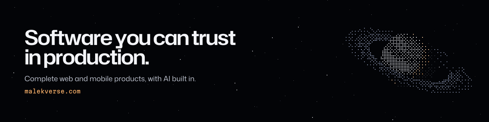

### Hi, I'm Malek

Software engineer. I build complete products end to end: web and mobile apps, the backends behind them, and AI inside them where it earns its place.

`STATUS: SHIPPING` · Full Stack AI Engineer at **Korbyx** · [malekverse.com](https://malekverse.com)

---

#### Selected work

| Project | What it is | Highlights |
|---|---|---|
| [**TunisiaFlicks**](https://github.com/malekverse/tunisiaflicks) | Film & series discovery on the web, Android, Android TV and Windows | 380+ commits, solo · EN/FR/AR/Derja with right-to-left · tests and Android builds in CI on every push |
| [**Al-Murshid**](https://al-murshid-pro.netlify.app) | A calm daily companion for Muslims, on the web, iOS and Android | One TypeScript core for Next.js + Expo · widgets, alarms, Quran reader · iOS Simulator flows and Lighthouse budgets in CI |
| [**QTrust**](https://q-trust-saas.vercel.app) | Multi-tenant SaaS for Quranic schools + a tablet app for QR attendance | 28 tenant-scoped models · billing and three portals · AI admin agent whose writes wait for approval |
| [**Bridge**](https://bridgeforall.vercel.app) | Accessibility platform + Chrome extension (EN/FR/AR) | Hackathon to live product in 3 days · on-device audio ML (~150 ms) · 19 automated RLS checks |
| [**Win El Dhaw**](https://wineldhaw.vercel.app) | Live power-outage map for Tunisia | Web reports, a Telegram bot and a news scraper → PostGIS DBSCAN zones, in real time |
| [**Edah Studio**](https://edah-studio.onrender.com/) | Written lecture → narrated Arabic/English video | 3D presenter · frame-accurate MP4 export · a 5-layer gate against invented facts |

Open source: merged fix in [God's Eye View](https://github.com/bilawalsidhu/gods-eye-view) (48k+ ★) · maintainer of [quran-dataset](https://github.com/malekverse/quran-dataset)

#### Stack
`TypeScript` `React` `Next.js` `React Native` `Expo` `Electron` `Node.js` `Hono` `NestJS` `Python` `FastAPI` `PostgreSQL` `MongoDB` `Supabase` `AWS` `Terraform` `Docker` `GitHub Actions` `Turborepo` `Vercel AI SDK`

#### Elsewhere
[LinkedIn](https://www.linkedin.com/in/malek-maghraoui) · [malekverse.com](https://malekverse.com)
